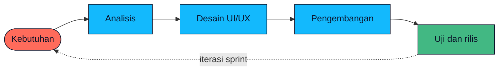
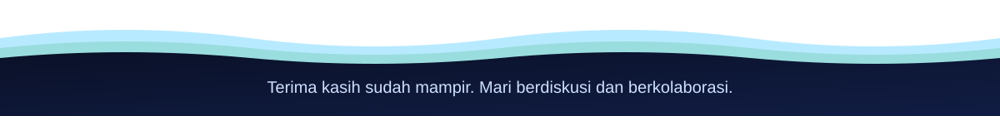

## Halo, saya Lailiyatus Sa'adah

Saya analis sistem yang mengawal produk dari awal sampai akhir: menggali kebutuhan, merancang alur dan antarmuka (UI/UX), lalu membangunnya menjadi aplikasi web dan mobile. Saya juga memakai kecerdasan buatan untuk mempercepat pekerjaan tanpa mengorbankan kualitas.

- **Sedang dikerjakan:** Fatayat_NU, Profile Web
- **Sedang dipelajari:**  Integrasi AI ke aplikasi Laravel]
- **Boleh ditanya soal:** Analisis kebutuhan, UI/UX, Laravel dan Livewire, Flutter
- **Cara bekerja:** Agile, dengan iterasi pendek dan umpan balik rutin

## Teknologi dan keahlian

| Fokus | Yang saya gunakan |
| :-- | :-- |
| **Analisis dan desain** |     |
| **Antarmuka web** |     |
| **Backend dan data** |     |
| **Mobile** |  |
| **Kecerdasan buatan** |  |

## Cara saya bekerja

Setiap fitur melewati lingkaran yang sama, sehingga kebutuhan bisnis tetap terhubung dengan hasil akhirnya.

## Proyek pilihan

<!-- Samakan dengan repositori yang Anda pin di profil. 3 proyek yang rapi lebih baik daripada 6 yang campur aduk. -->

| Proyek | Masalah yang diselesaikan | Teknologi |
| :-- | :-- | :-- |
| [nama-proyek-1](https://github.com/USERNAME/nama-proyek-1) | [Satu kalimat: untuk siapa dan apa manfaatnya] | Laravel, Livewire, MySQL |
| [nama-proyek-2](https://github.com/USERNAME/nama-proyek-2) | [Satu kalimat] | Flutter |
| [nama-proyek-3](https://github.com/USERNAME/nama-proyek-3) | [Satu kalimat] | Vue, Laravel API |

## Berbagi ilmu

<!-- Hapus bagian ini bila repositori catatan belum dibuat. -->

Catatan singkat, studi kasus analisis sistem, dan tips UI/UX saya kumpulkan di [USERNAME/til](https://github.com/USERNAME/til).

## Statistik

<!--
  Opsional. Kartu ini dibuat oleh layanan pihak ketiga yang bisa terkena batas akses (rate limit).
  Jika gambar gagal tampil, hapus blok ini. Profil Anda tetap lengkap tanpanya.
-->

<picture>
  <source media="(prefers-color-scheme: dark)" srcset="https://github-readme-stats.vercel.app/api?username=USERNAME&show_icons=true&hide_border=true&bg_color=0A1128&title_color=13B9FD&text_color=C9D1D9&icon_color=42B883" />
  
</picture>

## Mari terhubung

